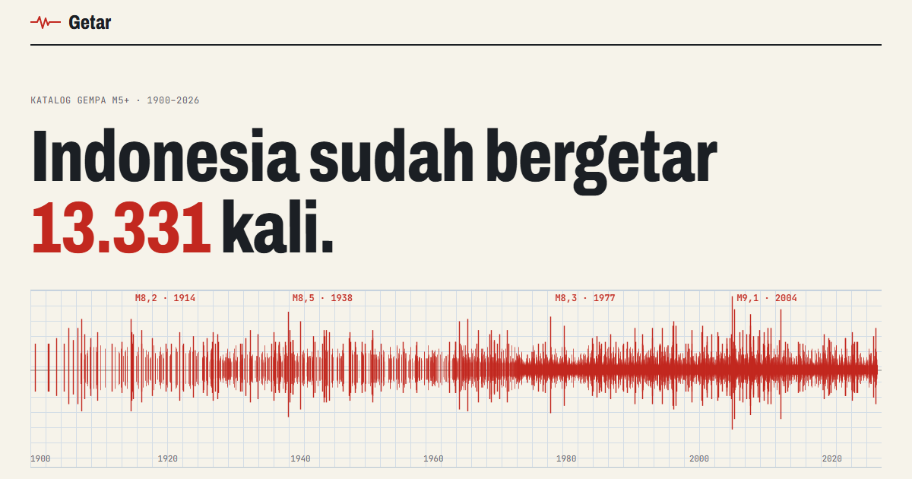

# Getar



**[Buka Getar](https://getar.vercel.app)**

Seberapa sering daerahmu diguncang gempa? Getar memetakan 13 ribu lebih gempa
bermagnitudo 5 ke atas di Indonesia sejak 1900 dari katalog USGS, lalu menjawabnya per
kabupaten/kota.

- **Pita seismogram**: setiap gempa sejak 1900 digambar sebagai satu garis setinggi
  magnitudonya, dengan tooltip.
- **Di sekitar daerahmu**: pilih satu dari 514 kabupaten/kota dan radius 100, 150, atau
  300 km. Hasilnya jumlah gempa M5+/M6+/M7+, yang terkuat dan terakhir, lima terkuat,
  serta peta kecil. Setiap pilihan punya tautan sendiri (`#daerah=kota-palu&r=150`).
- **Peta semua gempa**: titik berukuran sesuai magnitudo dan berwarna sesuai kedalaman,
  bisa disaring M5+/M6+/M7+. Batas lempeng terlihat dengan sendirinya.
- **Sepuluh gempa terbesar**, **hukum Gutenberg–Richter** (nilai b dihitung dari data,
  ≈ 0,98), dan **jumlah gempa per tahun**, termasuk penjelasan kenapa angkanya naik.
- Mode gelap mengikuti sistem.

## Data

| Data | Sumber |
|---|---|
| Katalog gempa M5+ sejak 1900 | [USGS ComCat](https://earthquake.usgs.gov/fdsnws/event/1/) |
| Batas dan titik tengah kabupaten/kota | geoBoundaries ADM2 (BPS, WFP, OCHA ROAP; CC BY 3.0 IGO) |

Katalog diambil untuk kotak 12° LS–7° LU, 91°–142° BT. Gempa yang lebih dari 400 km
dari titik tengah kabupaten/kota mana pun, atau yang menurut USGS terjadi di negara
tetangga, dibuang. "Di sekitar" diukur dari titik tengah wilayah, bukan dari alamat.

Gempa sebelum ~1970 jauh kurang presisi dan banyak gempa M5–6 waktu itu tidak tercatat,
jadi nilai b dihitung dari data sejak 1990 saja. Ini catatan sejarah, **bukan
prakiraan**. Untuk gempa terkini dan peringatan tsunami, rujukannya
[BMKG](https://www.bmkg.go.id/gempabumi/).

```
npm run data                     # unduh ulang katalog USGS lalu bangun public/data/gempa.json
node data/skrip/bangun.mjs       # bangun ulang dari data/mentah tanpa internet
```

Peta dasar (`public/data/peta.json`) memakai TopoJSON yang sama dengan
[Tebak Daerah](https://github.com/Reverseflash45/tebak-daerah).

## Warna

Tiga warna kedalaman (dangkal, menengah, dalam) adalah skala urut satu rona merah–oranye
yang divalidasi terhadap latar terang dan gelap. Gempa dangkal paling gelap di mode
terang dan paling terang di mode gelap, karena itulah yang paling merusak.

## Menjalankan

```
npm install
npm run dev
npm test        # analisis: jarak, kelas kedalaman, Gutenberg–Richter (vitest)
npm run build
```

Vite + TypeScript, tanpa framework UI; peta dengan d3-geo dan topojson-client. Titik
gempa digambar di kanvas supaya 13 ribu titik tetap ringan.
